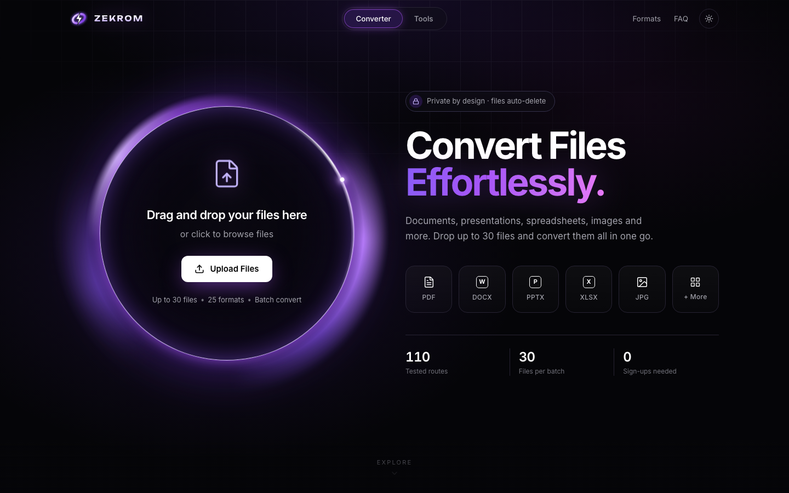
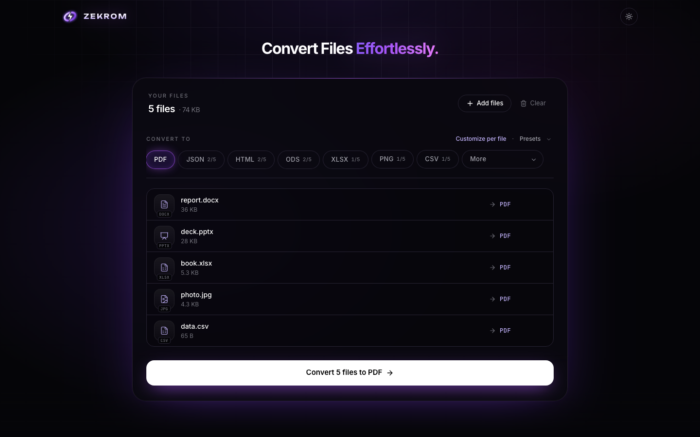
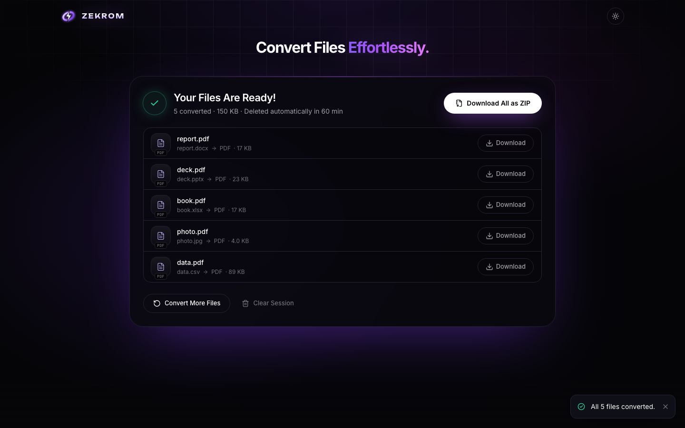
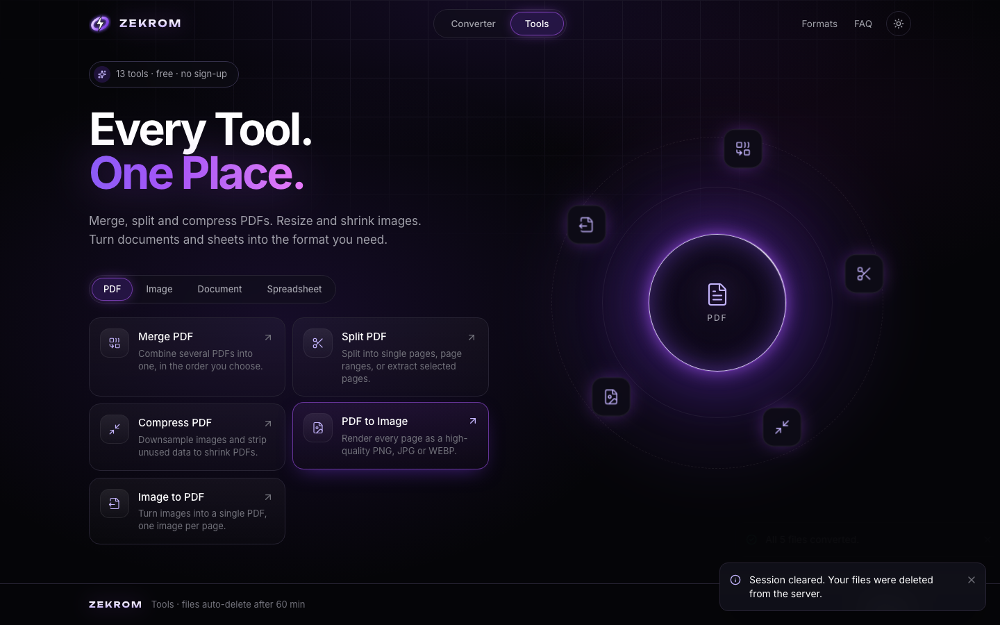

# Zekrom

I kept running into the same annoying thing: needing a bunch of files in a different format (a few slides as PDF, a spreadsheet as CSV, some photos as WebP), and every online converter doing one file at a time, or asking me to sign up.

So I built Zekrom. Drop up to 30 files, pick a format, click once, download everything as a zip.

**Try it:** https://zekrom-09tu.onrender.com (free instance, so give it up to a minute to wake up if nobody's used it lately)



## What it does

- Converts **documents, slides, spreadsheets, images, PDFs and data files** (110 routes across 25 input formats)
- Handles a **mixed batch** in one go: one format for everything, or a different one per file
- Only shows formats your files can actually become, so you never get a broken output
- Has a separate **Tools** page: merge / split / compress PDF, images to PDF, resize and compress images
- No account. Files get deleted automatically after an hour (or straight away with "Clear Session")

| Picking a format | Done | Tools |
|---|---|---|
|  |  |  |

## Running it

You need Python 3.11+, Node 20+ and LibreOffice. LibreOffice does the Word / PowerPoint / Excel conversions, and without it those formats just get hidden.

```bash
# macOS: brew install --cask libreoffice
# Ubuntu: sudo apt install libreoffice python3-uno

git clone https://github.com/ganesh-tadigadapa/Zekrom.git && cd Zekrom
cd backend && python3.11 -m venv .venv && .venv/bin/pip install -r requirements.txt && cd ..
cd frontend && npm install && cd ..

scripts/dev.sh   # api on :8000, site on http://127.0.0.1:5173
```

There's also a `Dockerfile` if you want a single container (it builds the frontend and serves everything from one place):

```bash
docker build -t zekrom . && docker run -p 7860:7860 zekrom   # http://localhost:7860
```

### Deploying

It runs on Render's free plan using the `render.yaml` in this repo:

[](https://render.com/deploy?repo=https://github.com/ganesh-tadigadapa/Zekrom)

Every push to `main` redeploys it. The free plan is small (512 MB of RAM, a tenth of a CPU), so `render.yaml` tunes for it: one conversion at a time, 50 MB per file, 200 MB per batch. Things to expect there:

- It sleeps after 15 minutes without visitors; the first visit after that takes about a minute.
- The first Office conversion after a wake-up waits ~30 s more while LibreOffice starts. After that, a Word or PowerPoint file takes roughly 10 s.
- Fine for personal use and a few friends. For real traffic, run the Docker image on a machine with more headroom (Oracle Cloud's Always Free tier works).

If you have Hugging Face PRO (Docker Spaces need it), `scripts/deploy-hf.sh <your-hf-username>` deploys there instead.

## How it's put together

```
backend/    FastAPI + the actual converters
  app/engines/   one file per kind of conversion (office, images, pdf, text, data)
  app/registry.py   every supported "X → Y" lives here
  app/jobs.py      the queue: runs things in parallel, retries, cleans up
  app/office_server.py   keeps one LibreOffice running so Office files skip the start-up
frontend/   React + Tailwind + Framer Motion
docs/       screenshots
```

A few things I cared about:

- **Real conversions, tested.** `pytest` generates a sample of every format and runs every single conversion in the registry, checking the output is really what it claims to be (not just renamed).
- **One bad file doesn't ruin the batch.** Each conversion runs in its own process with a timeout, and whatever succeeds is still downloadable.
- **Speed.** LibreOffice is slow to start, so one copy stays running (through [unoserver](https://github.com/unoconv/unoserver)) and Office files are fed to it. If it can't start or crashes, Zekrom quietly falls back to launching LibreOffice per batch. Images and PDFs run in a separate lane. A mixed 30-file batch takes about 4 seconds on my laptop.
- **Low memory.** Photos going into a PDF are embedded as-is instead of decoded, so a stack of 12 MP phone pictures doesn't blow through a 512 MB server (and it's ~5x faster).
- **Uploads are checked properly.** The file's bytes have to match its extension, archives are checked for zip bombs, and filenames can't escape the temp folder.

## Tests

```bash
cd backend
.venv/bin/python -m pytest -q                 # every conversion + the API
.venv/bin/python tests/e2e_ui.py /tmp/e2e     # clicks through the real UI (needs scripts/dev.sh running)
.venv/bin/python tests/bench.py <samples>     # 30-file speed check
```

## Settings

Everything is an environment variable: `ZEKROM_MAX_FILES` (30), `ZEKROM_MAX_FILE_MB` (100), `ZEKROM_MAX_BATCH_MB` (500), `ZEKROM_WORKERS`, `ZEKROM_OFFICE_WORKERS`, `ZEKROM_TIMEOUT`, `ZEKROM_RETENTION_S` (3600), `ZEKROM_RATE_LIMIT`, `ZEKROM_SCAN_COMMAND` (plug in a virus scanner like `clamdscan`), `ZEKROM_UNOSERVER` (1 keeps one LibreOffice running; 0 starts it per batch instead), `ZEKROM_UNO_PYTHON` (a Python that can `import uno`; found automatically).

## Known limits

- PDF → Word rebuilds the layout, so complicated pages can shift a bit. Scanned PDFs have no OCR.
- HTML / EPUB → PDF keeps the text and structure but not fancy styling or images.
- The job queue lives in memory, so this runs as a single server. Fine for me; it would need Redis/Celery to scale out.
- No end-to-end encryption. Put it behind HTTPS if you host it.
- The always-running LibreOffice needs a Python with the `uno` module (`python3-uno` on Debian/Ubuntu, already in the Docker image). On macOS it usually can't be used, so local runs there start LibreOffice per batch. Same results, just slower.

## Built with

FastAPI, LibreOffice, unoserver, PyMuPDF, pdf2docx, Pillow, openpyxl, React, Tailwind, Framer Motion, Lucide.

## License

MIT, see [LICENSE](LICENSE). Use it, fork it, host your own.
